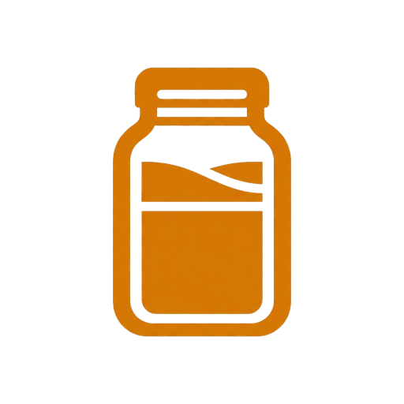
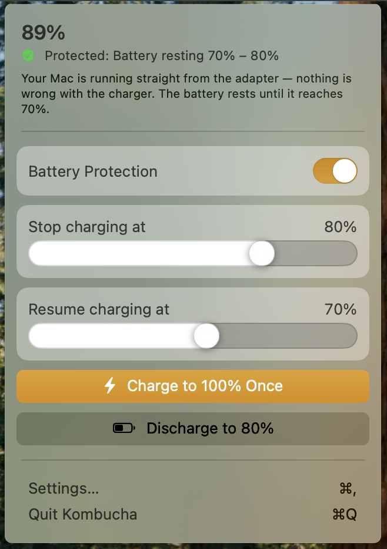
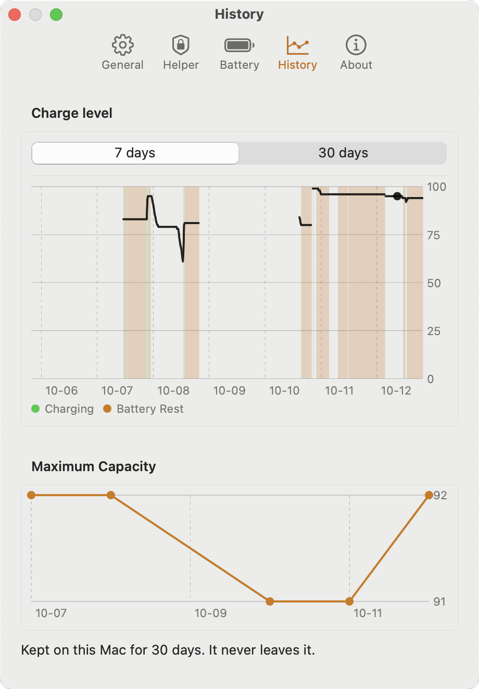
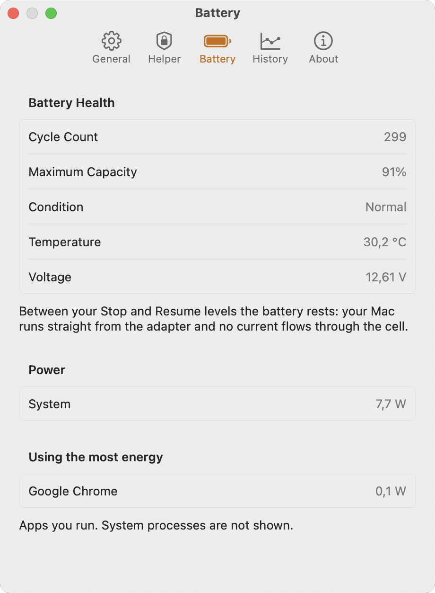

<p align="center">
  
</p>

# Kombucha

Limit MacBook charging from the menu bar to extend battery lifespan. A native Swift app.

A MacBook that stays on its adapter spends its life at 100%, the level at which a lithium-ion cell
ages fastest. Kombucha holds the battery inside a range you choose: it stops charging at the upper
threshold and resumes at the lower one, so the Mac runs from the adapter while the battery rests.

## Features

- **Charge range.** Set where charging stops (55–95%) and where it resumes (40–85%). Default 80% / 75%.
- **Charge to 100% Once.** Suspends the range for one full charge, then returns to it by itself.
- **Heat Protection.** Pauses charging at 40 °C and resumes at 37 °C.
- **Menu bar panel.** Level, status, sliders and the protection switch; an optional percentage next to the icon.
- **History.** Seven- and thirty-day charts of the charge level, charging and Battery Rest periods, and
  the maximum capacity trend. Stored on your Mac only.
- **Battery health.** Cycle count, maximum capacity, condition, temperature and live power readings.
- **Notifications.** Full charge finished, protection stopped or resumed, capacity drop, hot battery,
  and a charge limit that is not holding.
- **Discharge to the limit.** Switches the adapter off while the cable stays in, runs on the battery down to
  the stop level, then switches the adapter back on.
- **Shortcuts.** App Intents for Shortcuts, Spotlight and Siri.
- **Safe by design.** A small helper daemon writes two SMC keys — the charge inhibit and the adapter
  switch — and nothing else. It refuses callers it cannot verify. No network access, accounts or telemetry.
- **Stays out of the way.** Kombucha detects another running battery manager and leaves charging to it.

<p align="center">
<picture>
  <source media="(prefers-color-scheme: dark)" srcset="docs/images/panel-dark.png">
  
</picture>
</p>

<p align="center">
<picture>
  <source media="(prefers-color-scheme: dark)" srcset="docs/images/settings-history-dark.png">
  
</picture>
<picture>
  <source media="(prefers-color-scheme: dark)" srcset="docs/images/settings-battery-dark.png">
  
</picture>
</p>

More in [docs/screenshots.md](docs/screenshots.md).

## Requirements

- Apple Silicon MacBook whose SMC publishes the `CHTE` key.
- macOS 15 to 26. macOS 27 and later are not supported yet.
- One administrator approval in System Settings → General → Login Items & Extensions to enable the helper.

## Install

With [Homebrew](https://brew.sh):

```sh
brew install --cask askuksov/tap/kombucha
```

Or by hand:

1. Download `Kombucha-<version>.zip` from the [latest release](https://github.com/askuksov/kombucha/releases/latest) and unzip it.
2. Move `Kombucha.app` to `/Applications`.

Then open Kombucha and approve the helper once in System Settings → General → Login Items & Extensions.

The app is signed with a Developer ID and notarized by Apple.

## Building

`make help` lists shortcuts for the commands below (`make build`, `make install`, `make test`).

Xcode 26 (macOS 26 SDK), [XcodeGen](https://github.com/yonaskolb/XcodeGen) and an Apple Development certificate.

The Xcode 26 app itself needs macOS 26.2 to launch. On an older macOS, build from the terminal with its
command-line tools; the built app still runs on macOS 15:

```sh
export DEVELOPER_DIR=/Applications/Xcode.app/Contents/Developer
```

```sh
xcodegen generate
xcodebuild -project Kombucha.xcodeproj -scheme Kombucha -configuration Release \
  -derivedDataPath build/DerivedData build
```

The helper refuses callers it cannot verify, so an unsigned build starts but cannot change charging.
To build under your own team, copy `Config/Local.xcconfig.example` to `Config/Local.xcconfig` and set
your team ID.

Tests:

```sh
xcrun swift test --package-path Packages/KombuchaKit
xcodebuild -scheme Kombucha -configuration Debug -derivedDataPath build/DerivedData \
  -destination 'platform=macOS,arch=arm64' test
```

The first command covers `KombuchaKit`. The second builds and launches the app to run `KombuchaTests`:
the engine against fakes, lifecycle included; `AppModel` on that engine; the helper client against an
XPC stand-in inside the test process; the settings store against a throwaway defaults suite; the pure
halves of the power source, wake, SMC and battery health readers; a real process scan; the helper
registration status mapping; the exactly-once reply gate; the test-host guard and the delegate that
builds no engine inside it; and the code signing requirements against the binaries this machine just
signed. Nothing in it registers the helper, starts the wake monitor or writes to the SMC.

Launching the built app outside the tests starts a live engine: it registers the helper and, unless
another charge manager is running, sends charge commands.

## License

[MIT License](LICENSE)
