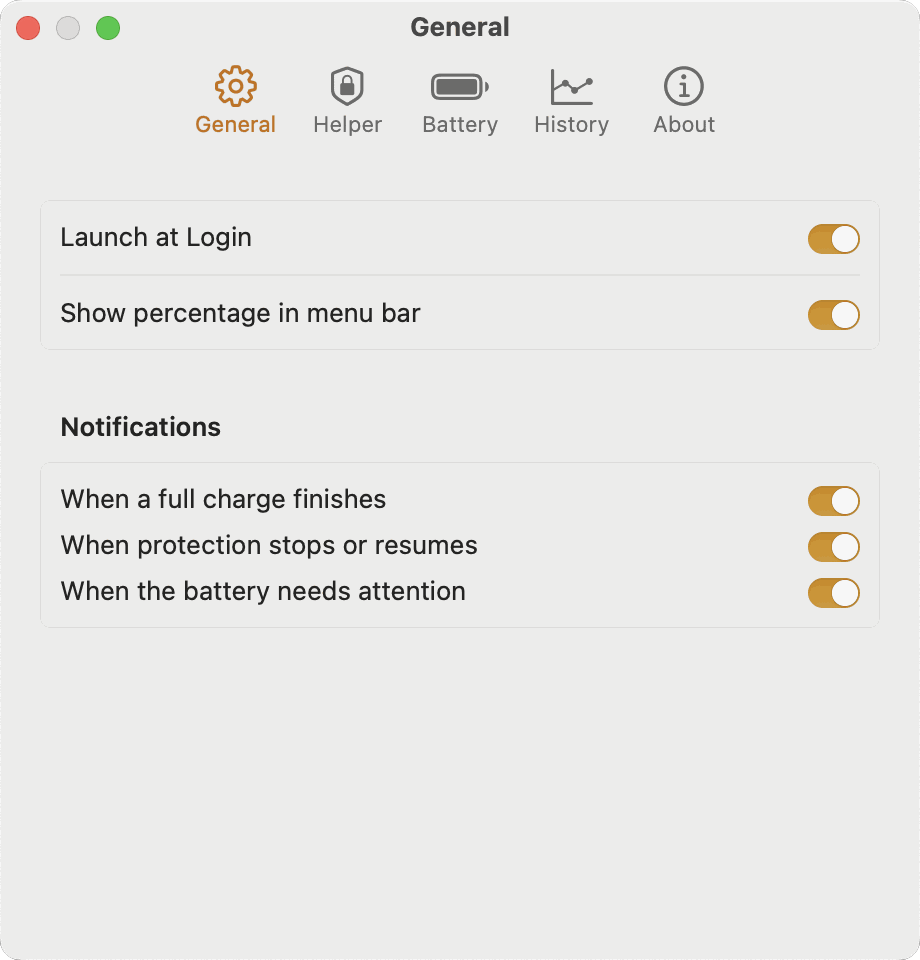
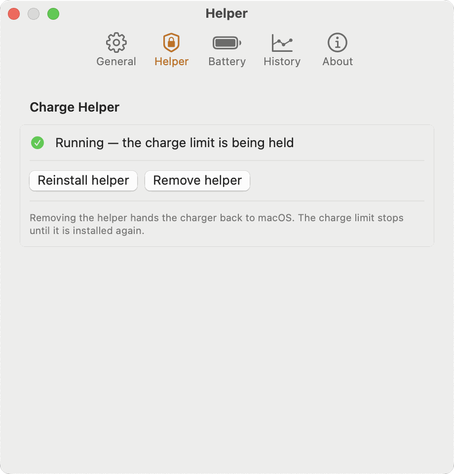
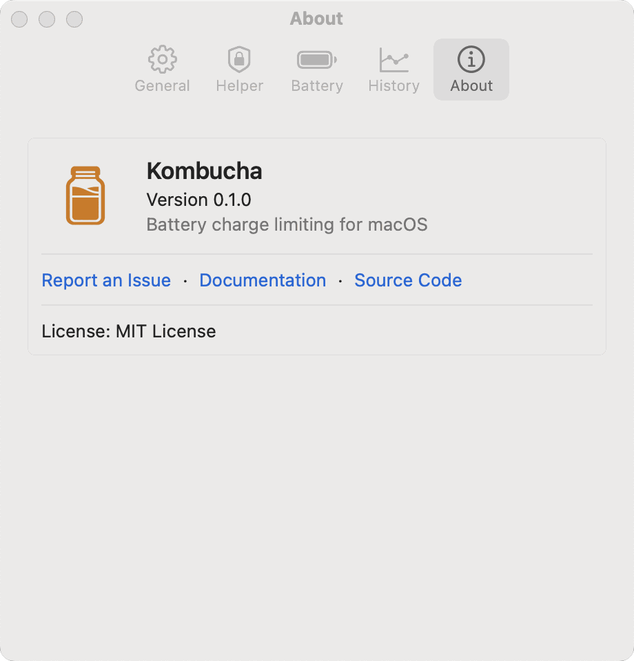
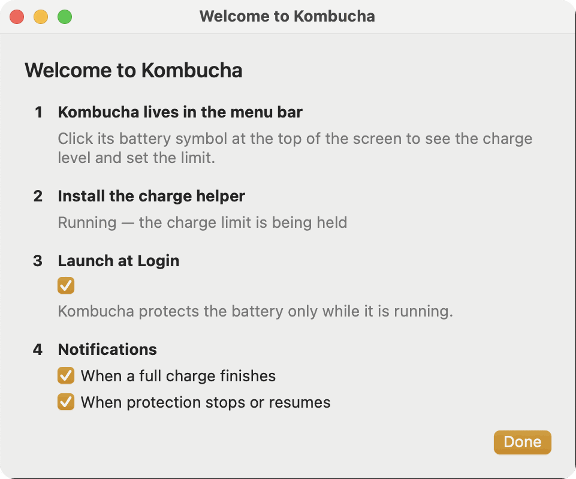
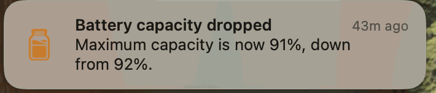

# Screenshots

The images follow your light or dark appearance.

## Menu bar panel

<picture>
  <source media="(prefers-color-scheme: dark)" srcset="images/panel-dark.png">
  
</picture>

## Settings

<picture>
  <source media="(prefers-color-scheme: dark)" srcset="images/settings-general-dark.png">
  
</picture>
<picture>
  <source media="(prefers-color-scheme: dark)" srcset="images/settings-helper-dark.png">
  
</picture>

<picture>
  <source media="(prefers-color-scheme: dark)" srcset="images/settings-battery-dark.png">
  
</picture>
<picture>
  <source media="(prefers-color-scheme: dark)" srcset="images/settings-history-dark.png">
  
</picture>

<picture>
  <source media="(prefers-color-scheme: dark)" srcset="images/settings-about-dark.png">
  
</picture>

## Welcome

## Notification

